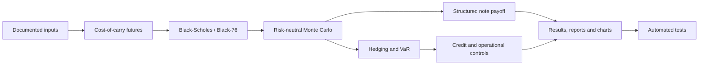
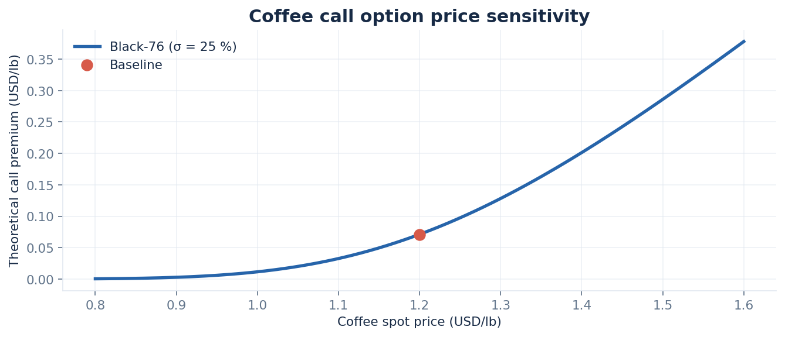
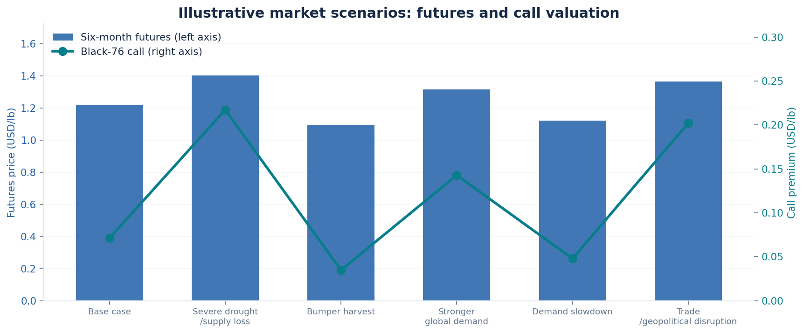
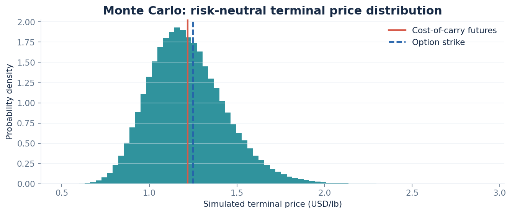
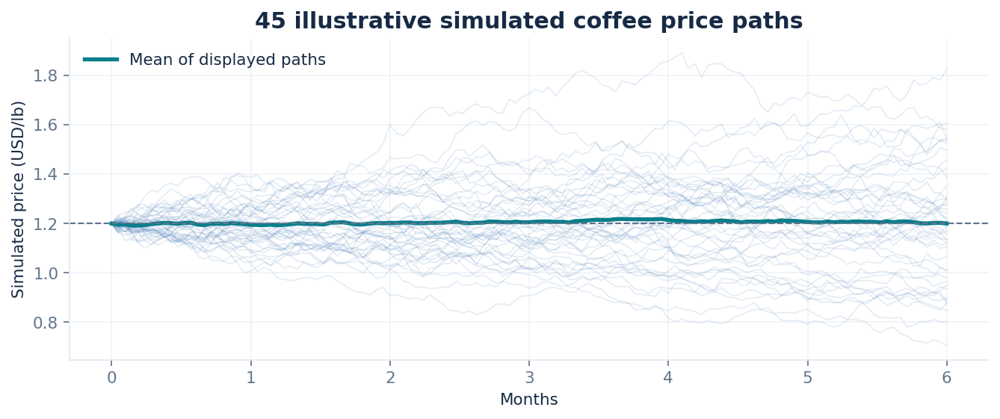
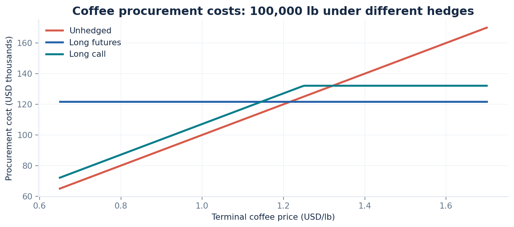
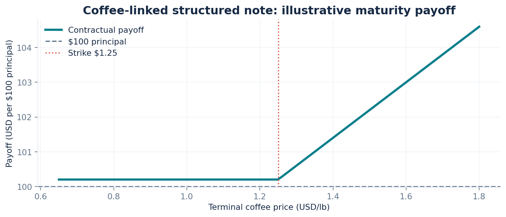
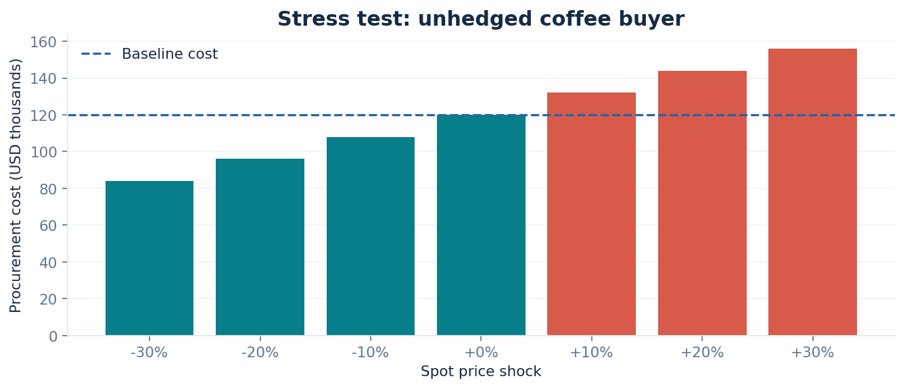

# Coffee Futures — Quantitative Pricing & Risk Management

[](https://www.python.org/) [](https://github.com/gonzalomontebelli/coffee-futures-quantitative-analysis/actions/workflows/ci.yml) [](LICENSE)

**An end-to-end, reproducible quantitative finance case study of coffee derivatives, structured products, and market, credit, and operational risk.**

> **Educational case study.** Independently developed from the Citi Markets Quantitative Analysis **virtual job simulation on Forage** (October 2026). This is **not an official Citi project, Citi employment, investment advice, proprietary market data, or evidence of work on Citi systems**. Core price inputs come from the exercise; selected deal terms, stress parameters, and counterparty assumptions are expressly illustrative.

[Methodology](docs/00_methodology.md) · [Data provenance](docs/07_data_provenance_and_limitations.md) · [Results](docs/06_results_and_interpretation.md) · [Knowledge checks](docs/05_knowledge_checks.md) · [Reports](reports/README.md) · [GitHub upload guide](GITHUB_UPLOAD_GUIDE.md)

## Project objective

Develop a transparent workflow that prices **six-month coffee futures**, values European options, verifies analytical results with **risk-neutral Monte Carlo**, explores hypothetical supply/demand and geopolitical shocks, structures an illustrative coffee-linked note, and evaluates **hedging plus market, counterparty, and operational risk**.



## Key reproducible results

| Measure | Result | Description |
|:--|--:|:--|
| Six-month coffee futures fair value | **$1.21814/lb** | Spot = $1.20, risk-free = 2%, storage = 1% |
| Spot-based European call | **$0.06836/lb** | Black-Scholes learning-guide comparison |
| European call on futures | **$0.07119/lb** | Black-76 benchmark |
| Monte Carlo call estimate | **$0.07141/lb** | 200,000 terminal draws, random seed 42 |
| One-month 95% parametric VaR | **~$14,245** | Hypothetical unhedged 100,000-lb exposure |
| Expected supplier credit loss | **$3,600** | Illustrative PD = 5%, LGD = 60%, EAD = $120,000 |
| Preliminary structured-note budget headroom | **~$0.2275 per $100** | Before fees, funding and credit charges |

Results above are **model outputs, not executable market quotes or empirical risk forecasts**. Values may be rounded for display. The model assumes continuously compounded financing and proportional storage rates with zero convenience yield.

## Visual analysis

**Option premium sensitivity to the coffee spot price**



**Illustrative market scenarios (not empirical forecasts)**



**Monte Carlo distribution and sample price paths**





**Hedging, structured-note payoff, and stress testing**







Each chart is available in both **PNG and SVG**; the plotting code is in [`visualizations.py`](src/coffee_quant/visualizations.py).

## Run the full analysis

Requires **Python 3.10+**. From the repository root:

```bash
python -m venv .venv
# macOS or Linux:
source .venv/bin/activate
# Windows PowerShell: .venv\Scripts\Activate.ps1

python -m pip install -r requirements.txt
python scripts/run_analysis.py
python -m pytest -q
```

To adjust the Monte Carlo sample count:

```bash
python scripts/run_analysis.py --n-simulations 200000 --seed 42
```

All parameters are editable in [`data/inputs.json`](data/inputs.json). Scenario assumptions are in [`data/illustrative_scenarios.csv`](data/illustrative_scenarios.csv). The script regenerates `results/metrics.json`, the CSV outputs, and all seven visualizations. A step-by-step [Jupyter notebook](notebooks/01_reproducible_analysis.ipynb) reproduces the key calculations. [GitHub Actions](.github/workflows/ci.yml) runs automated tests and a quick chart-generation smoke test.

## Repository organization

```text
coffee-futures-quantitative-analysis/
├── README.md                         # English landing page
├── GITHUB_UPLOAD_GUIDE.md            # Publication instructions
├── LICENSE                           # MIT license for original code
├── .github/workflows/ci.yml          # Automated CI
├── data/                              # Educational assumptions and scenarios
├── docs/                              # Nine English case-study chapters
├── src/coffee_quant/                 # Reusable Python models
├── scripts/run_analysis.py           # Reproducible analysis entry point
├── tests/                             # Automated unit tests
├── notebooks/01_reproducible_analysis.ipynb
├── results/                           # Recomputed JSON/CSV outputs
├── assets/figures/                    # Seven charts (PNG and SVG)
├── reports/                           # Original English PDF/DOCX deliverables
└── archive/original-report-builders/  # Historical report-generation source
```

## Learning path: four tasks

| Task | Focus | Case documentation |
|---|---|---|
| 1 · Financial mathematics | Probability, calculus, statistics, linear algebra, stochastic processes | [Mathematical foundations](docs/01_mathematical_foundations.md) |
| 2 · Commodity pricing | Cost of carry, Black-Scholes, Black-76, Monte Carlo, price shocks | [Pricing coffee futures and options](docs/02_commodity_pricing.md) |
| 3 · Hedging and structuring | Futures/call/put hedges, structured notes, client risk profiles | [Hedging and structured products](docs/03_hedging_and_structured_products.md) |
| 4 · Risk management | VaR, sensitivity, stress tests, counterparty due diligence, execution controls | [Market, credit and operational risk](docs/04_risk_management.md) |

## Important modeling distinctions

1. **Futures versus spot options:** Black-Scholes is included to reproduce the course exercise, whereas **Black-76** is used for European options on futures.
2. **Pricing versus prediction:** The Monte Carlo simulation uses a **risk-neutral** drift for model-consistency checking, not a physical probability forecast.
3. **Stress versus observation:** All additional weather, demand and geopolitical shocks are **analyst-designed assumptions**. They are not measured event effects.
4. **Contract design:** The proposed structured note is hypothetical. Principal repayment is **conditional on issuer solvency**, not an unconditional guarantee.
5. **Practical implementation:** Actual deployment requires exchange specifications, contract sizing, delivery grade, futures curves, option implied volatility, margin, liquidity, basis, counterparty exposure, compliance and independent model validation.

## Source and attribution

The educational context is based on [Citi / Forage: Global Quantitative Analysis Analyst virtual experience](https://www.theforage.com/virtual-experience/fAuNBibfF4dzrgtDY/citi/global-quantitative-analysis-analyst-6b4m). The analysis, charts, explanatory case-study documentation, and modular scripts in this repository were independently prepared for the exercise. No confidential Citi datasets or original course templates are distributed. Original source code is made available under the [MIT license](LICENSE). **Citi is mentioned only to attribute the educational scenario; no endorsement or affiliation is implied.**
