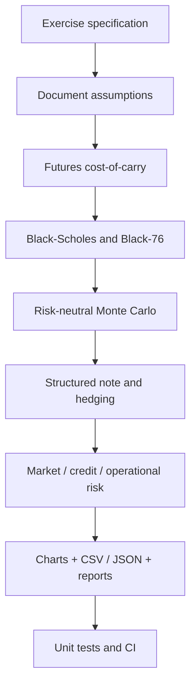

# Methodology and Project Workflow

## Case context

This independent academic case follows the **Citi Markets Quantitative Analysis virtual job simulation on Forage**. In the simulation, Aisha supervises the internship; Raj and Ravi contribute pricing and quantitative analysis; Rae focuses on Python and forecasting; Sarah covers risk management. These characters and situations are part of the educational case, **not a record of actual employment at Citi**.

## What we did, step by step

1. **Define the economic problem.** Coffee growers, buyers, and investors need instruments to manage volatility. The relevant risk drivers are crop supply, demand, weather, geopolitical events, storage costs, financing, and contract delivery specifications.
2. **Review financial mathematics.** Probability, inference, calculus, linear algebra, stochastic calculus, regression, ARIMA/GARCH, Black-Scholes, risk-neutral valuation, and VaR.
3. **Record instructional data.** Coffee spot price $1.20/lb, annual risk-free rate 2%, annual storage carry 1%, time to maturity 0.5 years, strike $1.25/lb, volatility 25%. Other terms are clearly tagged as analyst-created examples.
4. **Price the futures contract.** Apply a simplified cost-of-carry relationship, `F = S * exp((r + u - y) * T)`, with zero convenience yield in the baseline.
5. **Price the option.** Preserve the course's spot-based Black-Scholes calculation and add Black-76 for a call on the coffee futures benchmark.
6. **Check model consistency.** Draw 200,000 risk-neutral GBM terminal prices with seed 42, discount the option payoffs, and compare the Monte Carlo mean with Black-76 and a confidence interval.
7. **Explore shocks.** Vary hypothetical spot prices and volatility to illustrate supply loss, strong harvests, changing demand, and geopolitical trade disruption.
8. **Choose an investor profile.** Study four alternatives: conservative commodity-linked bonds, moderate-risk notes, high-risk digital options, and diversification via futures ETFs. Select the moderate-risk structured-note example for the submission.
9. **Measure and mitigate risk.** Quantify a hypothetical purchaser hedge, one-month parametric VaR, supplier expected loss, stress scenarios, and preventive/detective operational controls.
10. **Package and test.** Save machine-readable inputs and outputs, reproducible charts, a Jupyter notebook, clear technical chapters, unit tests, and English PDF/DOCX educational deliverables.

## Workflow diagram

## Audit trail

- Source inputs: [`data/inputs.json`](../data/inputs.json)
- Hypothetical shocks: [`data/illustrative_scenarios.csv`](../data/illustrative_scenarios.csv)
- Core financial functions: [`src/coffee_quant/`](../src/coffee_quant/)
- Main execution script: [`scripts/run_analysis.py`](../scripts/run_analysis.py)
- Reproducible notebook: [`notebooks/01_reproducible_analysis.ipynb`](../notebooks/01_reproducible_analysis.ipynb)
- Computed outcomes: [`results/`](../results/)
- Tests: [`tests/`](../tests/)

## Interpretation boundaries

This project does **not** calibrate empirical forecasts, trade real contracts, verify ICE quotes, or use proprietary Citi datasets. Reproducing an analytical option formula by simulation is a numerical cross-check, not evidence of forecasting power or profitability. See [provenance and limitations](07_data_provenance_and_limitations.md).
