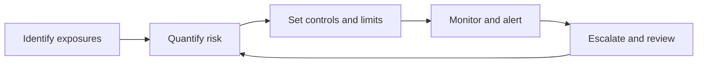

# Task 4 — Market, Credit and Operational Risk Management

## Risk framework

The final simulation task asked for controls addressing **rising coffee prices for a physical buyer**, **a new supplier in a volatile economy**, and **manual trade-execution errors**. Risk management consists of identification, measurement, mitigation, monitoring, escalation, and periodic independent review.

## Scenario 1 — Market risk: hedging coffee procurement

Assume a buyer plans to purchase **100,000 lb** in six months and adverse weather may push prices higher. Two candidate protections are **long futures** and **long calls**. Under full matching and zero basis, theoretical futures are **$1.21814/lb** and the six-month Black-76 call premium is **$0.07119/lb**, strike **$1.25/lb**.

| Terminal spot (USD/lb) | Unhedged purchase cost | Long futures: total cost | Long call: total cost |
|---:|---:|---:|---:|
| $0.96 | $96,000 | $121,814 | $103,119 |
| $1.20 | $120,000 | $121,814 | $127,119 |
| $1.44 | $144,000 | $121,814 | $132,119 |

The table shows **net commodity procurement cost**, not the derivative-only P&L. It ignores slippage, margins, funding, basis and fees. The illustrative 100,000-lb exposure is not asserted to be one exchange lot.

### Parametric VaR

A simple zero-mean, normal-return linear approximation is

$$\mathrm{VaR}_{\alpha}\approx P\,z_{\alpha}\,\sigma\sqrt h.$$

For an **unhedged $120,000 exposure**, annual volatility 25%, `h=1/12` year, and a 95% normal quantile, the one-month VaR is **approximately $14,245**. VaR is a loss **quantile**, not a strict maximum. This approximation omits jumps, stressed correlations and nonlinear payoff effects.

### Stress and monitoring

Test coffee-price shocks of **±10%, ±20%, and ±30%**. Add independent stress assumptions for volatility spikes, changing basis, exchange liquidity, margin calls, exchange-rate shifts and delivery disruption. Monitor hedge ratios, liquidity buffers and margin requirements daily or as exposure warrants.

## Scenario 2 — Credit risk: onboarding a new supplier

A supplier from a financially volatile region may fail to deliver, default on advance payments, or force the buyer to secure costly replacement supply.

- **Due diligence:** beneficial ownership, audited accounts, financing, delivery record, country/currency transfer risk, sanctions, concentration, and alternative capacity.
- **Credit scoring:** financial ratios, suitable logistic models and ratings where calibrated. An Altman Z-score is **not** universally reliable for every supplier type and is not computed for a real counterparty here.
- **Expected credit loss:** `EL = PD * LGD * EAD`. Hypothetical values: `PD=5%`, `LGD=60%`, `EAD=$120,000` produce **$3,600** expected loss.
- **Mitigation:** reduce prepayments; use a reliable bank letter of credit, performance bond or escrow; apply collateral haircuts, country/supplier limits and alternate sourcing.
- **Monitoring:** late shipments, covenant breaches, score deterioration, collateral sufficiency and concentration triggers.

**CDS caveat:** Credit default swaps are not necessarily available for privately held suppliers; a financial CDS is not automatically a contractual guarantee of physical coffee delivery.

## Scenario 3 — Operational risk: execution errors

Manual trade processing can introduce duplicate orders, wrong directions, incorrect volumes, bad price inputs, failed settlement reconciliation, permission problems, or stale feeds.

| Control stage | Proposed action |
|---|---|
| Prevention | Pre-trade instrument/price/size checks, limit validation, authorized users, dual approval for exceptions, duplicate detection |
| Detection | Order-to-fill-to-clearing reconciliations, automated exception alerts and execution quality reports |
| Containment | Kill switch, reduced limits, safe rollback and documented escalation |
| Recovery | Incident review, resilient infrastructure, backup procedures and staff retraining |
| Measurement | Errors per 1,000 orders, unresolved breaks, mean time to detect and recover |

Automation must be validated and monitored; **a trading signal such as a moving-average crossover is not by itself an operational control**.

## Cross-risk control cycle

Proposed monitoring cadences are instructional, **not confirmed internal Citi policies**. See the [Task 4 report](../reports/Task_4_Risk_Management.pdf).
